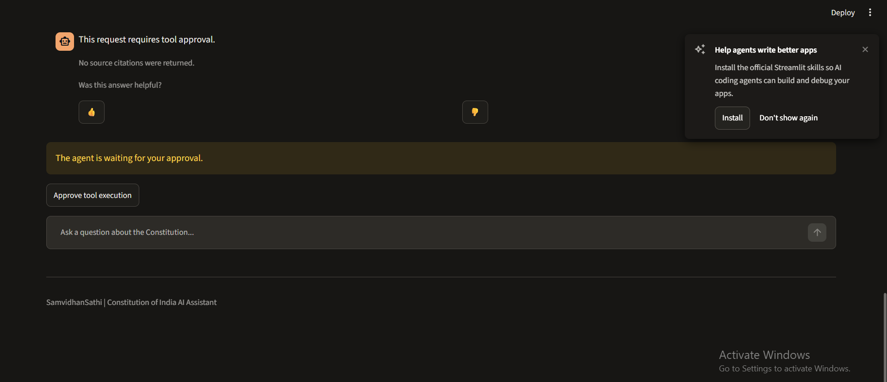

## Checkpoint 2 – Streamlit UI

SamvidhanSathi now includes an interactive Streamlit interface.

### Features
- AI-powered Constitution Q&A
- RAG and Agent assistant modes
- Source citations
- Thumbs up/down feedback collection
- Article Card with original constitutional text
- Plain-English Article explanations
- Amendment history footnotes

### Application Screenshot



### Run the Application

Start the FastAPI backend:

```bash
uvicorn app.main:app --reload

Save the file.

### Step 2: Commit and push

Run:

```powershell
git add README.md
git commit -m "docs: add development checks"
git push origin feature/day-12-ci-demo


## Development Checks

Run code quality checks:

```bash
ruff check .


### Then save and run these commands in PowerShell:

```powershell
git add README.md
git commit -m "docs: add development checks"
git push origin feature/day-12-ci-demo


## Day 12 - CI/CD

- Automated testing using GitHub Actions.
- Code quality checks using Ruff.
- Automated tests using Pytest.
- Docker image build verification.