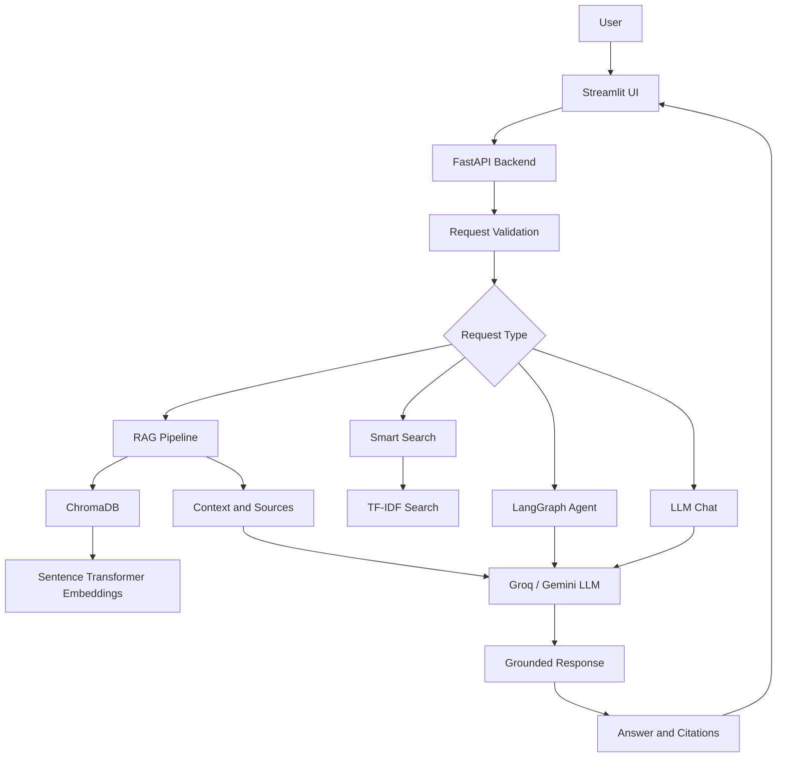

# SamvidhanSathi 🇮🇳
### AI-Powered Constitution of India Assistant


SamvidhanSathi is an AI-powered assistant that helps users understand the Constitution of India through intelligent search, Retrieval-Augmented Generation (RAG), and conversational AI.

It retrieves relevant constitutional provisions and provides simple explanations with source references, making constitutional information easier to access and understand.

## Problem Statement

The Constitution of India contains extensive legal language and numerous articles, amendments, and provisions. For students and ordinary citizens, finding relevant information and understanding complex constitutional terminology can be challenging.

Traditional keyword searches may not understand the meaning or context behind a question.

## Solution

SamvidhanSathi combines semantic search, RAG, and LLM-based responses to help users ask questions in natural language and receive contextual answers grounded in constitutional records.

## Key Features

- AI-powered Constitution question answering.
- Retrieval-Augmented Generation (RAG).
- Semantic search using Sentence Transformers and ChromaDB.
- LangGraph-based agent workflow with approval handling.
- Article-level source references and citations.
- Plain-English constitutional explanations.
- Interactive Streamlit chat interface.
- Thumbs-up and thumbs-down feedback collection.
- Prompt versioning and response caching.
- API latency and LLM token monitoring.
- Input validation and prompt-injection testing.

## Technology Stack

| Category | Technologies |
|---|---|
| Backend | Python, FastAPI |
| Frontend | Streamlit |
| AI / LLM | Groq, Google Gemini |
| RAG | Sentence Transformers, ChromaDB |
| Agent Workflow | LangGraph |
| Search | TF-IDF, Semantic Search |
| Data Processing | Pandas |
| Testing | Pytest |
| Code Quality | Ruff |
| Deployment | Render, Docker |
| CI/CD | GitHub Actions |

## Architecture



## Application Screenshot


## Live Deployment

**Live Frontend (Streamlit):** https://samvidhansathi.streamlit.app/

**Live API (Render):** https://samvidhansathi-api.onrender.com

**Health Check:** https://samvidhansathi-api.onrender.com/health

**API Documentation (Swagger):** https://samvidhansathi-api.onrender.com/docs

Deployment platform: Render

## Demo Video

**Project demonstration:** Coming soon.

<!-- Replace the line above with your public YouTube or Google Drive demo link when available. -->

## Results and Performance

The following values were recorded during local development tests.

| Metric | Result |
|---|---:|
| Health endpoint latency | 82.41 ms |
| First chat request (cache MISS) | 3069.80 ms |
| Repeated chat request (cache HIT) | 39.96 ms |
| Cache hit latency reduction | 98.7% |
| Groq input tokens (measured request) | 358 |
| Groq output tokens (measured request) | 450 |
| Groq total tokens | 808 |
| Prompt-injection unit test | 1 passed |

**Note:** These are individual development measurements, not results from a production load test. Response latency varies with provider response time and network conditions.

## Production Notes

- Request latency and HTTP status codes are logged through FastAPI middleware.
- LLM input and output token usage is captured from provider metadata.
- In-memory cache stores up to 100 responses.
- Maximum question length is 2,000 characters.
- Prompt versions are validated.
- RAG retrieval limits are restricted to 1–10.
- Prompt-injection unit testing verifies that grounding instructions remain in the constructed prompt.

## Running Locally

Clone the repository:

```bash
git clone https://github.com/Sanika78/GenAI_EXAMATE_4.git
cd GenAI_EXAMATE_4
```

Create and activate a virtual environment:

```bash
python -m venv .venv
```

Windows PowerShell:

```powershell
.\.venv\Scripts\Activate.ps1
```

Install dependencies:

```bash
pip install -r requirements.txt
```

Configure your API keys using `.env.example` as a reference. Never commit your `.env` file.

Start the FastAPI backend:

```bash
uvicorn app.main:app --reload
```

Start the Streamlit frontend in another terminal:

```bash
streamlit run ui/app.py
```

## Testing and Code Quality

Run the test suite:

```bash
python -m pytest tests/ -v
```

Run Ruff:

```bash
ruff check .
```

GitHub Actions automatically runs code quality checks, tests, and Docker image build verification.

## Repository Structure

```text
GenAI_EXAMATE_4/
│
├── app/
│   ├── main.py
│   ├── llm.py
│   ├── rag.py
│   ├── vectorstore.py
│   ├── embed.py
│   ├── graph.py
│   ├── agent_loop.py
│   ├── smart_search.py
│   └── cache.py
│
├── data/
├── docs/
├── eval/
├── prompts/
├── screenshots/
├── tests/
├── ui/
│
├── Dockerfile
├── docker-compose.yml
├── requirements.txt
└── README.md
```

## Future Improvements

- Expand constitutional data coverage.
- Improve evaluation using a larger question-answer dataset.
- Add automated adversarial prompt testing.
- Introduce persistent distributed caching.
- Monitor performance under concurrent user requests.

## Author

**Sanika Adhav**

GitHub: [Sanika78](https://github.com/Sanika78)

---

*SamvidhanSathi – Making the Constitution of India easier to explore and understand.*
